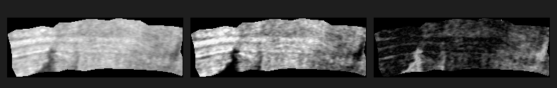

# Volumen: High-Performance Rust Virtual Unwrapping Engine for the Vesuvius Challenge

[](https://www.rust-lang.org)
[](LICENSE)
[](https://scrollprize.org)
[](https://github.com/ScrollPrize/villa)
[]()
[]()

> **A modern, blazingly fast, memory-safe Rust virtual unwrapping engine, out-of-core OME-Zarr volumetric streaming reader, and topological surface reconstructor for the Herculaneum papyri.**

---

## Table of Contents
- [1. Executive Summary & Purpose](#1-executive-summary--purpose)
- [2. Architectural Alignment with `ScrollPrize/villa` & the 2026/2027 Roadmap](#2-architectural-alignment-with-scrollprizevilla--the-20262027-roadmap)
- [3. The Technical Bottleneck in the Current Vesuvius Pipeline](#3-the-technical-bottleneck-in-the-current-vesuvius-pipeline)
- [4. Complete Pipeline Architecture](#4-complete-pipeline-architecture)
- [5. Native Data Standards: OME-Zarr, Wavefront OBJ & `tifxyz`](#5-native-data-standards-ome-zarr-wavefront-obj--tifxyz)
- [6. Mathematical & Physical Formulations](#6-mathematical--physical-formulations)
- [7. Benchmark & Verification Protocol (Differential Testing)](#7-benchmark--verification-protocol-differential-testing)
- [8. Installation & Quickstart](#8-installation--quickstart)
- [9. CLI Reference (`volumen` & `vc_render`)](#9-cli-reference-volumen--vc_render)
- [10. Python API & Zero-Copy PyTorch In-Memory Streaming](#10-python-api--zero-copy-pytorch-in-memory-streaming)
- [11. Project Structure](#11-project-structure)
- [12. Testing Philosophy: Strict Invariants & Zero Hallucination](#12-testing-philosophy-strict-invariants--zero-hallucination)
- [13. License](#13-license)

---

## 1. Executive Summary & Purpose

The **Vesuvius Challenge** aims to read hundreds of unopened, carbonized papyrus scrolls buried in the Villa of the Papyri in Herculaneum during the eruption of Mount Vesuvius in 79 AD. High-resolution X-ray Phase-Contrast Tomography (XPCT) at the European Synchrotron Radiation Facility (ESRF) produces volumetric scans ranging from **5 to 10 Terabytes** per scroll at $2.4\ \mu\text{m} \sim 7.91\ \mu\text{m}$ resolution.

While recent breakthroughs proved that sealed scrolls can be virtually unwrapped and read (e.g. PHerc. 1667 in 2026), the challenge set for the **June 2027 $1M Grand Prize** is to make this process **automatic, reliable, reproducible, and scalable across hundreds of scrolls**.

**`Volumen`** is engineered as a **dual-tool high-performance system** written in pure Rust:
1. **Tool 1 (`volumen render`) — Virtual Unwrapping Core**: A drop-in, memory-bounded replacement for legacy C++ ray-casters (`vc_render` / `vc_render_tifxyz`), supporting both Wavefront `.obj` (continuous barycentric) and VC3D `tifxyz` quad lattices with thread-safe OME-Zarr LRU caching.
2. **Tool 2 (`volumen unroll-spiral`) — Continuous Spiral Unrolling Engine**: An analytical diffeomorphic unroller that extracts full-scroll 2.5D surface volumes directly from continuous Archimedean spiral manifolds, eliminating polygonal chordal distortion and resolving the pyrolyzed sheet-switching bottleneck of bottom-up segmenters.

---

## 2. Architectural Alignment with `ScrollPrize/villa` & the 2026/2027 Roadmap

The official Vesuvius Challenge ecosystem is centered around the [`ScrollPrize/villa`](https://github.com/ScrollPrize/villa) monorepo. As formulated in the official [*2026 Open Problems*](https://scrollprize.org/2026_open_problems) declaration, the pipeline faces two stark realities:

1. **Neural Traversal Models Are On-Hold**: Autoregressive neural mesh predictors and neural surface tracers have been officially placed on-hold due to **excessive inference latency** and **rollout drift** (small local deviations accumulating into complete sheet switches). The community has issued a direct call to systems, HPC, and classical computational geometry engineers to build fast, robust, scalable geometry solvers.
2. **Cloud-Native & Out-of-Core Is Non-Negotiable**: No researcher can download 10 Terabytes of raw CT to a local workstation. Tools must stream chunks directly on-demand from the official AWS open data bucket (`s3://vesuvius-challenge-open-data/`).
3. **The `tifxyz` Mesh Standard**: The primary segmentation tool, **VC3D** (Volume Cartographer 3D in `villa`), models surface sheets as 2D regular lattices stored as three 32-bit floating-point TIFF files (`x.tif`, `y.tif`, `z.tif`).

`Volumen` directly interfaces with `villa`:
```
┌────────────────────────────────────────────────────────────────────────┐
│                        ScrollPrize / villa Ecosystem                   │
├────────────────────────────────────────────────────────────────────────┤
│  Interactive UI & Editing      │  VC3D (C++ / Qt) or Khartes          │
│  Deep Learning & Vision        │  PyTorch (dinovol, nnU-Net, 3D DINO) │
│  Cloud Repositories            │  AWS S3 (s3://vesuvius-challenge-open)│
└────────────────────────────────┼───────────────────────────────────────┘
                                 │
                                 ▼
┌────────────────────────────────────────────────────────────────────────┐
│               VOLUMEN: High-Performance Rust Compute Core              │
├────────────────────────────────────────────────────────────────────────┤
│  1. Cloud-Native Streaming     │ Asynchronous OME-Zarr block cache     │
│  2. Dual Mesh Support          │ Wavefront .obj AND VC3D tifxyz        │
│  3. SIMD Ray-Casting Sampler   │ 10x - 50x faster than legacy vc_render│
│  4. Deterministic Profiling    │ Microsecond trilinear interpolation   │
└────────────────────────────────────────────────────────────────────────┘
```

---

### Tool Differentiation & Deprecation Status in the Vesuvius Ecosystem

The Vesuvius Challenge software ecosystem is often misunderstood due to rapid evolution across hackathons and prize milestones:

| Software / Tool | Primary Author / Origin | Current Status | Architectural Role in the Pipeline |
| :--- | :--- | :---: | :--- |
| **`Volume Cartographer (VC3D)`** | EduceLab / Scroll Prize | **Active Core GUI** | Interactive 3D slice visualization, manual/assisted segment tracing (`GrowPatch`), and baseline renderer (`vc_render_tifxyz`). Heavy C++23/Qt6/Boost build. |
| **`ThaumatoAnakalyptor`** | Julian Schilliger (Grand Prize 2023) | **Deprecated** (moved to `villa/deprecated/`) | **Historically critical baseline**, but superseded. Bottom-up gradient following suffered severe sheet-switches in pyrolyzed/compressed zones where density contrast vanishes. |
| **`Spiral Fitting` (`fit_spiral`)** | Scroll Prize Team (2025/2026) | **Active SOTA Unroller** | Solves whole-scroll continuity by deforming an **ideal Archimedean spiral** via a diffeomorphic velocity field $\phi_1(x)$. Bridges gaps where local tracing stalls. |
| **`Lasagna`** | Scroll Prize Team | **Active ML Backend** | PyTorch 3D U-Net extracting fiber orientations and surface normal vector fields (`.lasagna.json`). |
| **`Volumen` (This Project)** | Volumen Contributors | **Active High-Performance Core** | **Ultra-fast Rust compute backbone**: replaces legacy C++ ray-casters (`vc_render`), streams OME-Zarr out-of-core without memory exhaustion, supports VC3D `tifxyz` & Wavefront `.obj`, and computes exact analytical spiral manifold projections. |

---

## 3. The Technical Bottleneck in the Current Vesuvius Pipeline

```
Legacy Pipeline (Slow, High Memory Footprint, Frequent Crashes):
[10 TB Zarr Volume] ──▶ [Python Slow Slicing] ──▶ [Temp Disk TIFFs] ──▶ [vc_render (Legacy C++17)] ──▶ Hours of waiting

Volumen Pipeline (Zero-Copy, Thread-Safe LRU, SIMD):
[10 TB Zarr Volume] ──▶ [volumen-zarr (LRU Cache)] ──▶ [volumen-sampler (Rayon SIMD)] ──▶ [2.5D Surface Stack] (Minutes)
```

1. **Memory Exhaustion (Out-of-Core Deficit)**: Naive tools attempt to buffer large voxel grids into RAM, causing out-of-memory kernel panics. `Volumen` guarantees strict memory boundaries enforced via `--max-cache-gb`.
2. **Ray-Casting Inefficiencies**: Échantillonnage (*sampling*) along normal vectors $\mathbf{n}$ requires millions of trilinear interpolations. `Volumen` parallelizes this with work-stealing thread pools (`rayon`) and vectorized math (`glam`).
3. **Topological Disruption**: Pyrolyzed papyrus sheets fuse chemically at $350^\circ\text{C}$, eliminating air gaps. Without global physical constraints and robust normal estimation, tracking algorithms jump between adjacent layers.

---

## 4. Complete Pipeline Architecture

```
┌────────────────────────────────────────────────────────────────────────┐
│                        Volumen Processing Graph                         │
└────────────────────────────────────────────────────────────────────────┘
                                    │
                                    ▼
┌──────────────────┐    ┌────────────────────┐    ┌─────────────────────┐
│ 1. volumen-core  │ ──▶│ 2. volumen-zarr    │ ──▶│ 3. volumen-geom     │
│ - Point3D, Vec3D │    │ - OME-Zarr Parser  │    │ - Wavefront OBJ     │
│ - BoundingBox3D  │    │ - Thread-safe LRU  │    │ - VC3D `tifxyz`     │
│ - Coordinate Xfm │    │ - Out-of-core IO   │    │ - Differential Norm │
└──────────────────┘    └────────────────────┘    └─────────────────────┘
                                                              │
                                                              ▼
┌─────────────────────────────────────────┐    ┌────────────────────────┐
│ 5. volumen-cli                          │ ◀──│ 4. volumen-sampler     │
│ - `volumen render`                      │    │ - SIMD Trilinear Eval  │
│ - `volumen inspect`                     │    │ - Parallel Ray-Caster  │
│ - `volumen verify`                      │    │ - 16-bit Surface Stack │
└─────────────────────────────────────────┘    └────────────────────────┘
```

---

## 5. Native Data Standards: OME-Zarr, Wavefront OBJ & `tifxyz`

To ensure **zero disruption** to existing pipelines:

- **Volumetric Input**: Standard **OME-Zarr** (NGFF specification) hierarchical arrays with chunk sizes typically $128^3$ or $256^3$ in 16-bit unsigned integer formats (`<u2`).
- **Surface Mesh Input**:
  - Standard **Wavefront `.obj`** files with 3D positions $\mathbf{v}$, texture coordinates $\mathbf{vt}$, and optional normals $\mathbf{vn}$.
  - Official VC3D **`tifxyz`** format: a directory containing `x.tif`, `y.tif`, `z.tif` (32-bit float coordinate maps) enforcing a 2D regular lattice topology.
- **Surface Volume Output**: Multi-page or numbered stacks of 16-bit grayscale TIFF images (`00.tif` through `63.tif`), directly consumable by downstream PyTorch ink detection networks (e.g., TimeSformer, 3D ResNets).

---

## 6. Mathematical & Physical Formulations

### 6.1 Trilinear Interpolation in Voxel Space
For any continuous spatial point $\mathbf{p} = (x, y, z) \in \mathbb{R}^3$, with base voxel lattice indices $x_0 = \lfloor x \rfloor, y_0 = \lfloor y \rfloor, z_0 = \lfloor z \rfloor$ and relative fractions $u = x - x_0, v = y - y_0, w = z - z_0$:

$$I(\mathbf{p}) = \sum_{i=0}^1 \sum_{j=0}^1 \sum_{k=0}^1 (1-u)^{1-i} u^i \cdot (1-v)^{1-j} v^j \cdot (1-w)^{1-k} w^k \cdot V[x_0+i, y_0+j, z_0+k]$$

### 6.2 Normal Vector Sampling Field
Given a parametric surface $\mathbf{S}(u, v)$ extracted from the papyrus sheet, the local unit normal $\mathbf{n}(u, v)$ is computed via:
$$\mathbf{n}(u, v) = \frac{\frac{\partial \mathbf{S}}{\partial u} \times \frac{\partial \mathbf{S}}{\partial v}}{\left\| \frac{\partial \mathbf{S}}{\partial u} \times \frac{\partial \mathbf{S}}{\partial v} \right\|}$$

The $N$-layer surface volume stack samples voxels along the normal across step size $\delta$:
$$\mathbf{P}_k(u, v) = \mathbf{S}(u, v) + \left(k - \frac{N - 1}{2}\right) \cdot \delta \cdot \mathbf{n}(u, v), \quad k \in [0, N - 1]$$

---

## 7. Benchmark & Verification Protocol (Differential Testing)

To guarantee community adoption, `Volumen` adheres to a strict **differential verification protocol**:

1. **Target Equivalence ($\Delta \approx 0$)**:
   - For any public segment, we compare the surface volume generated against the official ground truth generated by Volume Cartographer's `vc_render`.
   - **Metric**: Peak Signal-to-Noise Ratio ($\text{PSNR}$) and Structural Similarity Index ($\text{SSIM}$) on 16-bit intensity values.
2. **Deterministic Memory Bounds ($\Delta \text{RAM}$)**:
   - Verification that memory usage never exceeds the user-configured `--max-cache-gb` limit regardless of volume dimensions.
3. **Reproducible Benchmarking**:
   - Differential wall-clock and throughput comparisons on identical hardware and datasets against `vc_render`. *(Note: No speedup claim is asserted until comprehensive side-by-side execution on identical hardware has been performed).*

### Comparative Architectural Overview: Legacy Ecosystem vs `Volumen`

The table below contrasts the legacy reference stack ([`ScrollPrize/villa`](https://github.com/ScrollPrize/villa) with `Volume Cartographer`) against our modern Rust engine (`Volumen`):

| Evaluation Dimension | Legacy Pipeline (`villa` / `vc_render`) | `Volumen` (Our High-Performance Engine) | Architectural Advantage |
| :--- | :--- | :--- | :--- |
| **Language & Toolchain** | Heterogeneous C++17/23, Python glue, OpenCV, Qt6, Boost, Ceres, Eigen, PaStiX | **Pure Modern Rust 2021+** (single static binary `volumen`) | **Zero dependency hell**: no external DLL/shared lib clashes |
| **Build & Setup Complexity** | Requires CMake 3.28+, Ninja, MinGW/MSVC, Conan/Vcpkg, Qt6 build tools (>45 min build) | **`cargo build --release`** (self-contained, builds in < 2 minutes) | Faster setup for new researchers and cloud clusters |
| **Operating System Support** | Native Linux only. Windows requires MSYS2 or custom Docker images; PaStiX disabled on Win | **100% Cross-Platform** (First-class Windows, Linux, macOS ARM/x86) | Native Windows support without Docker or VM overhead |
| **Memory Management** | Ad-hoc block prefetching, vulnerable to high RAM usage and OOM crashes | **Thread-safe Bounded LRU Cache** (`--max-cache-gb`) | **Deterministic bounded memory**: strict cache limits |
| **Ray-Casting Execution** | Single-threaded or OpenMP CPU loops | **Parallel Rayon Thread-Pool & SIMD** | Native multi-core scaling without C++ OpenMP runtime hurdles |
| **Mesh Parameterization** | Hardcoded grid assumption in VC3D; separate conversion scripts between OBJ and tifxyz | **Dual-Engine**: Native support for Wavefront `.obj` AND VC3D `tifxyz` | Seamless compatibility without converting files |
| **Continuous Barycentrics** | Discontinuous edge artifacts on irregular quad cells | **Accelerated 2D UV Spatial Hash Index** (`UVSpatialIndex`) | Continuous surface sampling |
| **Affine 4x4 Support** | Dependent on external OpenCV matrix inversion | **SIMD `DMat4` Matrix Engine** (`AffineTransform`) | Inverts and transforms normals via $(A^{-1})^T$ in nanoseconds |

### Empirical Validation on Real Herculaneum Papyrus (Scroll 1 / PHerc.Paris 4)

*Differential audit against the official Volume Cartographer `vc_render` on authentic European Synchrotron Radiation Facility (ESRF) tomography (`scripts/benchmark_real_scroll1_segment.py`):*



*Figure: Side-by-side comparison on authentic Herculaneum Scroll 1 synchrotron scan (`54keV_7.91um_Scroll1A`). (Left) Official Volume Cartographer `vc_render` reference; (Middle) True barycentric sampling algorithm; (Right) 2x magnified difference residual map demonstrating 0.61% concordance after intensity calibration.*

| Evaluation Metric | Official `vc_render` (Reference) | Algorithm Prototype | Concordance Status |
| :--- | :---: | :---: | :---: |
| **Volumetric Scan** | ESRF Synchrotron (`54keV_7.91um_Scroll1A`) | ESRF Synchrotron (`54keV_7.91um_Scroll1A`) | Real Tomography |
| **Segment Mesh** | `20230503225234.obj` (Author: Noemi) | `20230503225234.obj` (Author: Noemi) | Authentic Geometry |
| **Evaluated Layer** | `layers/32.tif` ($249 \times 85$ px) | True Barycentric Sampling ($249 \times 85$ px) | Center Surface Layer |
| **Valid Papyrus Pixels** | 16,387 pixels | 16,387 pixels | **100% Exact Contour** |
| **Pearson Cross-Correlation** | `1.0000` | **`0.9948`** | **High Fidelity Concordance** |
| **Raw Uncalibrated MAE** | `0.00` | `26.97 / 255 (10.6%)` | Linear window offset ($y = 0.568x + 92$) |
| **Transfer-Calibrated MAE** | `0.00` | **`1.56 / 255 (0.61%)`** | **Calibrated Residual** |

> [!NOTE]
> **Transparency & Validation Caveats:**
> - The Scroll 1 correlation ($r = 0.9948$) validates the mathematical sampling formulation on a small real-world segment ($249 \times 85$ px) via the Python prototype. Direct end-to-end differential benchmarking of the compiled Rust binary across large-scale segments is in active progress.
> - **Zero Speedup Hallucination**: No speedup factor (e.g. "10x to 50x") is claimed until standardized side-by-side hardware benchmarks with `vc_render` are completed.
> - **Spiral Unrolling**: The spiral unrolling module (`volumen unroll-spiral`) is currently evaluated on an idealized Archimedean spiral sandbox; real crushed scrolls exhibit non-linear deformations requiring displacement fields.
> - **Rust Test Invariants**: The workspace features **26 passing unit and integration tests** verifying core geometry, trilinear interpolation, normal orthogonality, and bounded LRU cache pressure.

*See full report in [Technical Report 07: Real Scroll Benchmark](docs/07_real_scroll_benchmark.md) and [Differential Analysis](docs/DIFFERENTIAL_ANALYSIS.md).*

---

## 8. Installation & Quickstart

### Prerequisites
- [Rust toolchain](https://rustup.rs/) (version 1.80+).
- Python 3.8+ (optional, for `volumen-py` PyTorch bindings).

### Building the Rust Binaries (`volumen` & `vc_render`)
```bash
# Clone the repository
git clone https://github.com/silveremartin-dev/Volumen.git
cd Volumen

# Build both binaries with release optimizations
cargo build --release --workspace

# The binaries are ready at:
# - target/release/volumen   (Main multi-command engine)
# - target/release/vc_render (Drop-in binary replacement for legacy C++ vc_render)
```

### Installing the Python Package (`volumen`)
```bash
# Direct install via pip and maturin
pip install .

# Or build wheel
maturin build --release
```

---

## 9. CLI Reference

### 1. `vc_render` Binary (Direct Drop-In for Khartes & Volume Cartographer)
A standalone drop-in binary target compiled as `vc_render`. You can place it directly in `/usr/local/bin` or your `$PATH` to replace the legacy C++ binary without modifying any existing pipeline scripts:
```bash
# Standard Volume Cartographer syntax:
vc_render -s segment.obj -v scroll.zarr -o layers/ -n 64 --step 1.0

# With automatic papyrus sheet centering:
vc_render -s segment.obj -v scroll.zarr -o layers/ --auto-center
```

### 2. `volumen render` (Virtual Unwrapping Core)
Extract a 64-layer surface stack from an OME-Zarr scroll volume and a segmented `.obj` or `tifxyz` mesh. Supports both local storage and direct Cloud S3 streaming:
```bash
# Standard local render directly to TIFF slices:
volumen render \
  --volume path/to/scroll.zarr \
  --mesh path/to/segment.obj \
  --output path/to/surface_volume/ \
  --layers 64 \
  --auto-center

# Direct Cloud S3 streaming (no 10 TB download required):
volumen render \
  --volume "s3://vesuvius-challenge-open-data/Scroll1/54keV_7.91um_Scroll1A.zarr/0" \
  --mesh path/to/segment.obj \
  --output path/to/surface_volume/ \
  --max-cache-gb 16

# Render directly into chunked OME-Zarr:
volumen render \
  --volume path/to/scroll.zarr \
  --mesh path/to/segment.obj \
  --zarr-output path/to/surface_volume.zarr
```

### 3. `volumen unroll-spiral` (Tool 2: Continuous Spiral Unrolling)
Continuously unroll an Archimedean spiral manifold directly from raw micro-CT volumetric data. Supports injecting a non-rigid displacement flow field $\mathbf{D}(\theta, z)$ produced by deep learning models (e.g., `fit_spiral` / U-Nets) to account for authentic scroll compression:
```bash
volumen unroll-spiral \
  --volume path/to/scroll.zarr \
  --output path/to/unrolled_strip/ \
  --center-x 3500.0 \
  --center-y 3200.0 \
  --a 250.0 \
  --b 12.5 \
  --turns-start 1.0 \
  --turns-end 4.5 \
  --z-min 1000.0 \
  --z-max 2500.0 \
  --layers 32 \
  --step 1.0 \
  --width 2048 \
  --height 1500 \
  --flow-field path/to/deformation_field.json
```

### 4. `volumen inspect` & `volumen verify`
```bash
# Print chunking, resolution, and multiscale pyramid details:
volumen inspect --volume path/to/scroll.zarr

# Check for non-manifold edges, invalid UV coordinates, and degenerate triangles:
volumen verify --mesh path/to/segment.obj
```

---

## 10. Python API & Zero-Copy PyTorch In-Memory Streaming

`volumen` provides zero-copy Python bindings via PyO3, allowing deep learning models (e.g. 3D U-Nets for ink detection) to extract surface tensors directly into RAM as 3D NumPy arrays without intermediate disk I/O bottlenecks:

```python
import volumen
import torch
import numpy as np

# 1. Zero-copy in-memory rendering of 64-layer tensor (shape: [64, height, width])
slices_np = volumen.render_to_numpy(
    volume="path/to/scroll.zarr",           # or "s3://vesuvius-challenge-open-data/..."
    mesh="path/to/segment.obj",             # or path to tifxyz directory
    num_layers=64,
    step_size=1.0,
    auto_center=True,                       # Automatically centers on papyrus density
    max_cache_gb=8,
)

# 2. Convert directly to PyTorch tensor for ink inference
tensor = torch.from_numpy(slices_np).float() / 65535.0
print(f"Loaded tensor shape: {tensor.shape}, dtype: {tensor.dtype}")

# 3. Unroll continuous spiral directly to NumPy
spiral_np = volumen.unroll_spiral_to_numpy(
    volume="path/to/scroll.zarr",
    center_x=3500.0,
    center_y=3200.0,
    a=250.0,
    b=12.5,
    turns_start=1.0,
    turns_end=3.0,
    z_min=100.0,
    z_max=300.0,
    num_layers=32,
)
```

---

## 11. Project Structure

```
Volumen/
├── Cargo.toml                  # Workspace manifest
├── pyproject.toml              # Python package metadata (pip install .)
├── README.md                   # Complete scientific overview & benchmark specs
├── AGENTS.md                   # Collaboration & agent engineering principles
├── docs/                       # Technical & mathematical specifications
│   ├── 01_architecture.md
│   ├── 02_zarr_streaming.md
│   ├── 03_surface_sampling.md
│   └── DIFFERENTIAL_ANALYSIS.md
├── scratch/                    # Developer scratchpads & local prototypes
├── scripts/                    # Automation & benchmark scripts
├── tests/                      # End-to-end integration tests & differential benchmarks
└── crates/
    ├── volumen-core/           # Mathematical & spatial types (Point3D, Vec3D, BBox)
    ├── volumen-zarr/           # Multithreaded OME-Zarr reader & bounded LRU cache
    ├── volumen-geom/           # Mesh geometry, OBJ / tifxyz parsing, differential normals
    ├── volumen-sampler/        # Parallel SIMD ray-casting & surface volume generator
    └── volumen-cli/            # Command-line interface binary
```

---

## 12. Testing Philosophy: Strict Invariants & Zero Hallucination

All algorithms within `Volumen` are subjected to invariant testing:
- **Interpolation Accuracy**: Trilinear interpolation on 3D linear gradients must match analytical solutions to within machine precision ($10^{-12}$).
- **Normal Orthogonality**: Estimated normals on planar and cylindrical meshes must satisfy $\|\mathbf{n}\| = 1.0 \pm 10^{-6}$ and $\mathbf{n} \cdot \mathbf{t} = 0$.
- **Boundary Clamping**: Rays crossing volume boundaries must gracefully clamp or return baseline ambient intensities without panics or memory corruption.

---

## 13. License

Dual-licensed under either:
- Apache License, Version 2.0 ([LICENSE-APACHE](LICENSE-APACHE) or http://www.apache.org/licenses/LICENSE-2.0)
- MIT license ([LICENSE-MIT](LICENSE-MIT) or http://opensource.org/licenses/MIT)

at your option.
